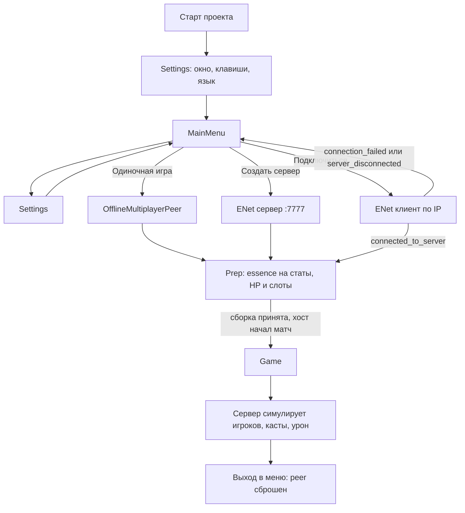

# Архитектура MVP

## Поток сессии



`Settings` и `NetworkManager` — Autoload, живут дольше сцен. `Settings` применяет окно, клавиши и язык до меню. `NetworkManager` держит `multiplayer.multiplayer_peer`. Сцена `Game` в `_ready` спрашивает менеджер, кого заспавнить, и пишет в игрока уже принятую сборку.

## Кто за что отвечает

| Узел | Роль |
|---|---|
| `Settings` | Графика, клавиши, локаль. Сеть не трогает |
| `NetworkManager` | Поднять пир, сменить сцену, очередь спавна, сигналы соединения, приём сборки |
| `MainMenu` | Три кнопки режима, поле IP, вход в настройки |
| `Prep` | Черновик трат `essence` до матча |
| `Game` | Мир, `MultiplayerSpawner`, контейнер сущностей |
| `Player` | Ввод владельца. На сервере — движение, стамина, здоровье, каст |
| `PlayerStats` | Данные и формулы траты `essence`. Сеть внутри ресурса не живёт |
| `SpellData` | Тип и параметры заклинания |
| `Destructible` | `hp` и `take_damage`. Уничтожение выполняет сервер |
| `Projectile` | Полёт и попадание считает сервер |

Проверка «это сервер?» стоит в методах, которые меняют мир. `PlayerStats` и `SpellData` остаются чистыми: их вызывают уже после проверки авторитета.

Авторитет игрового узла (`set_multiplayer_authority`) — всегда peer `1`, потому что положение считает сервер и `MultiplayerSynchronizer` шлёт состояние от авторитета узла. Владелец ввода — id в имени узла (`"1"`, `"2"`, …). Так сервер может реплицировать позицию, а клиент — слать RPC на пир `1`.

## Дерево сцены `Game.tscn`

```
Game (Node2D)  game.gd
├── Ground (Polygon2D)          заглушка пола, видна в редакторе
├── Entities (Node2D)           игроки, снаряды, стены
└── MultiplayerSpawner          spawn_path = NodePath("../Entities")
```

Пол лежит в сцене. Игроков, снаряды и стены сервер добавляет в `Entities` уже во время сессии: их нет, пока не пошла симуляция. Образцы этих объектов — отдельные packed scene.

## Будущие пути

Пути ниже — договорённость следующего прохода. Сейчас этих файлов нет.

```
res://autoloads/settings.gd
res://autoloads/network_manager.gd
res://locale/ui.csv
res://theme/ui_theme.tres
res://theme/ui_font.ttf
res://scenes/main_menu/main_menu.tscn
res://scenes/main_menu/main_menu.gd
res://scenes/settings/settings.tscn
res://scenes/settings/settings.gd
res://scenes/prep/prep.tscn
res://scenes/prep/prep.gd
res://scenes/prep/prep_rules.gd
res://scenes/game/game.tscn
res://scenes/game/game.gd
res://scenes/player/player.tscn
res://scenes/player/player.gd
res://scenes/spells/projectile.tscn
res://scenes/spells/projectile.gd
res://scenes/spells/area_zone.tscn
res://scenes/spells/area_zone.gd
res://scenes/spells/destructible_wall.tscn
res://scenes/spells/beam_flash.tscn
res://scenes/spells/self_flash.tscn
res://scenes/spells/nova_flash.tscn
res://scenes/spells/flash.gd
res://scenes/spells/mine.tscn
res://scenes/spells/mine.gd
res://scripts/destructible.gd
res://resources/player_stats.gd
res://resources/spell_data.gd
res://data/player_stats_default.tres
res://data/spells/spell_base.tres
```

В `project.godot` две автозагрузки, главная сцена — меню. `Settings` идёт первым:

```
[autoload]
Settings="*res://autoloads/settings.gd"
NetworkManager="*res://autoloads/network_manager.gd"

run/main_scene="res://scenes/main_menu/main_menu.tscn"
```

## Слои физики

Имена слоёв задаются в Project Settings. Биты общие для всех сцен.

| Бит | Имя | Кто на слое | Кого пересекает |
|---|---|---|---|
| 1 | `world` | `Destructible` (стена) | — |
| 2 | `players` | `Player` | `world` |
| 3 | `projectiles` | `Projectile` | маска задаётся элементом при спавне |
| 4 | `enemies` | будущие враги | `world` |
| 5 | `hazards` | тело мины | — |

Боевой снаряд и луч пересекают `world`, `hazards` и `enemies`. Свет пересекает `world`, `hazards` и `players`. Игрок слой `hazards` не маскирует и сквозь мину проходит. Подробности — в [spells.md](spells.md).

Группы:

- `destructibles` — стена вешает в `_ready` сама, мину в группу добавляет `mine.gd`;
- `players` — игрок, цель лечения светом;
- `enemies` — зарезервирована. Боевой урон получает узел с `take_damage(amount: float)` из `destructibles` или `enemies`.

## Репликация

`MultiplayerSpawner.spawn_path` = `Game/Entities`. В списке спавна:

- `res://scenes/player/player.tscn`
- `res://scenes/spells/projectile.tscn`
- `res://scenes/spells/area_zone.tscn`
- `res://scenes/spells/destructible_wall.tscn`
- `res://scenes/spells/beam_flash.tscn`
- `res://scenes/spells/self_flash.tscn`
- `res://scenes/spells/nova_flash.tscn`
- `res://scenes/spells/mine.tscn`

Сервер вызывает `add_child` в `Entities`. Копию на клиентах создаёт спавнер, у которого этот узел указан в `spawn_path`, а сцена лежит в списке спавна. Имя игрока — `str(peer_id)`. Имена заклинаний назначает сервер, авторитет узла — `1`.

`queue_free()` на сервере у заспавненного узла убирает его у всех пиров.

Позицию клиента задаёт репликация. Своего шага физики клиент не делает. Задержка владельца на удалённом клиенте — ограничение этого этапа; отдельного предсказания в контракте нет.

Какие поля везёт синхронизатор — в [player.md](player.md) и [spells.md](spells.md).

## Порядок на сервере за один кадр физики

1. Взять последний пакет ввода каждого владельца. Хост читает свой ввод локально.
2. Движение, стамина и проверка здоровья: при `current_hp <= 0` ввод этого пира в скорость не идёт.
3. Касты, пришедшие надёжным RPC: спавн снаряда или стены.
4. Шаг снарядов: луч, дистанция, таймер, `take_damage`.
5. Таймеры жизни стен.
6. Синхронизатор рассылает состояние.

Сборка статов и слотов приходит один раз на экране подготовки. В кадре матча `essence` больше не списывается.
